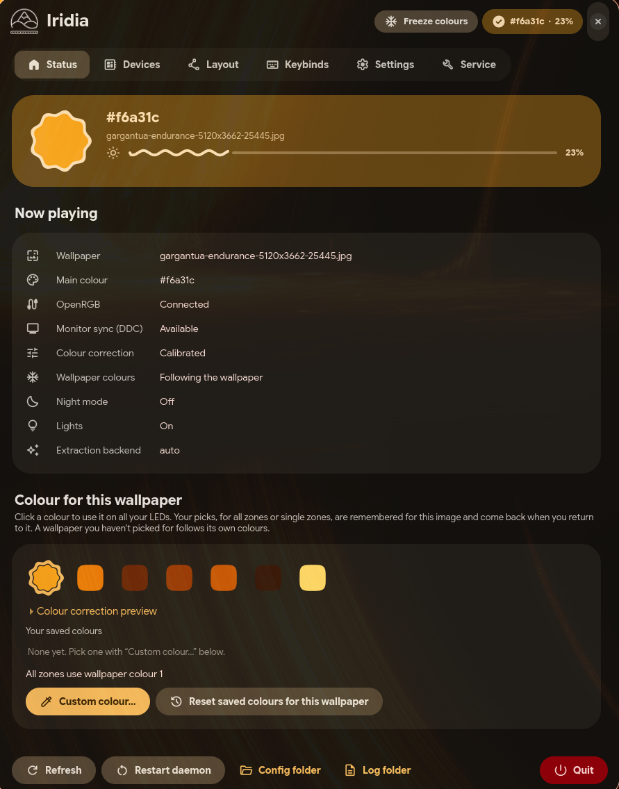
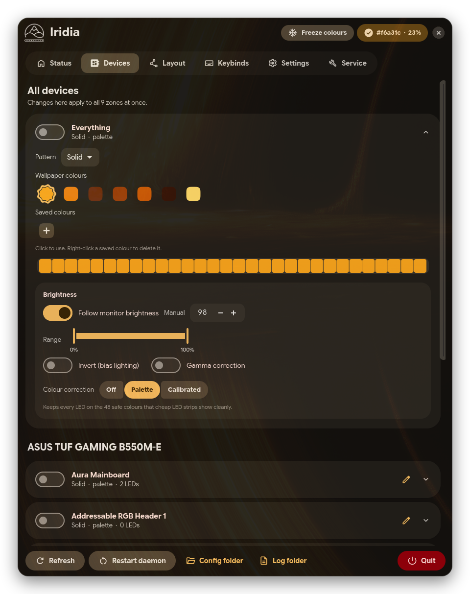
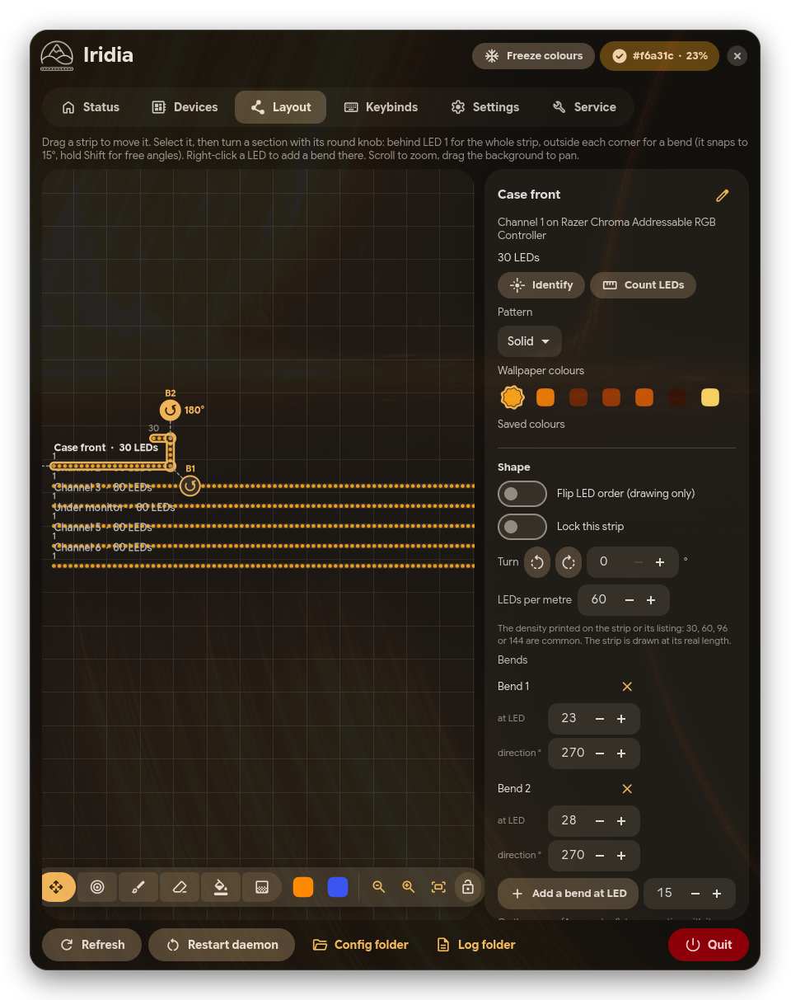

<p align="center"></p>
<h1 align="center">Iridia</h1>
<p align="center">Sets the RGB lights in your room and PC to the colours of your wallpaper, through OpenRGB.
It can also animate them, map them to your room, follow your monitor's brightness and show sensors.</p>
<p align="center">
  
  
  
  
  
  
</p>
<p align="center">
  <a href="#installation">Install</a> · <a href="#features">Features</a> · <a href="#how-it-works">How it works</a> ·
  <a href="#keyboard-shortcuts">Shortcuts</a> · <a href="CHANGELOG.md">Changelog</a>
</p>

---

> **AI disclosure:** This project was written almost entirely by an AI assistant, with direction and
> testing by the author. It has been tested on CachyOS with Hyprland and a Razer Chroma ARGB controller
> driving WS2812B strips, but not yet on every desktop or device, so review the code before relying on it.

<p align="center">
  
  
  
</p>

## Features

**Colours**
- The wallpaper's colours on LED strips, RAM, keyboards, fans and anything else OpenRGB drives.
- Finds the wallpaper on GNOME, KDE Plasma, XFCE, Cinnamon, MATE, COSMIC, Hyprland, Sway, niri and more.
- A pattern, colours and brightness for each zone; strips split into parts, or single LEDs set by hand.
- Seven animations, and a map of your room that gradients and animations run across.

**Around the PC**
- Follows your monitor's brightness (DDC/CI) or the laptop screen, dims at night, and goes off when the
  screen locks or the PC sleeps.
- Sensor bars for CPU temperature, load and memory; chosen LEDs flash for desktop notifications.
- WS2812B, WS2811, plain 12V RGB and RGBW strips, with colour order, colour correction and power limits.

**Control**
- Keyboard shortcuts, saved setups and automatic backups through the `iridia` command.
- Updates from the window, with a way back to the previous version.

Settings change only when you change them, and a backup is kept before anything big. Nothing of Iridia
goes outside your home folder. It uses about 0.1% of one CPU core with static colours.

## Installation

```sh
git clone https://github.com/HypestHyper/Iridia-LED.git
cd Iridia-LED
bash install.sh
```

You need [OpenRGB](https://openrgb.org/) 0.9 or newer (1.0 recommended), Python 3.8+ and GTK 4.6+;
ddcutil is optional, for monitor brightness. The installer finds what's missing, shows the command for
your package manager (pacman, apt, dnf, zypper, xbps or apk) and asks before running it. It installs
Iridia into `~/.local/share/iridia-venv`, links `iridia` and `iridia-gui` into `~/.local/bin`, and asks
how OpenRGB's server and the daemon should start (`--openrgb=daemon|systemd|off`,
`--autostart=systemd|xdg|compositor|none`; `--yes` takes the defaults, `--no-deps` leaves system
packages alone). Update from the *Updates* tab, with `iridia update`, or with `git pull && bash install.sh
--update`. `bash uninstall.sh` removes it (`--keep-settings` or `--purge`). The
[installation guide](docs/wiki/Installation.md) has the details.

## How it works

A small background service, `iridia-daemon`, watches the wallpaper, picks its main colours and sends them
to your devices through OpenRGB's SDK server, which it can start for you. The GTK 4 window and the
`iridia` command only change the daemon's settings, over a socket in `$XDG_RUNTIME_DIR`. The launcher
follows the freedesktop.org desktop entry spec, and the daemon starts at login through a systemd user
service, XDG autostart or a line in your compositor's config. The [wiki](docs/wiki/Home.md) explains
everything in detail.

## Command line

```sh
iridia status                                      # what's going on
iridia doctor                                      # what's wrong, if anything
iridia zone "Desk back" on color ff0000 bright 40  # for a keybind: run it again to switch back
iridia lights toggle                               # every LED off and on
iridia setup save "Evening"                        # keep this look
```

[Every command](docs/wiki/Command-Line.md) is in the wiki.

## Keyboard shortcuts

| Keys | In the window |
| --- | --- |
| Ctrl + Plus / Minus | Larger or smaller window contents |
| Ctrl + 0 | Automatic size |

Shortcuts for the lights themselves are set in your desktop: the *Keybinds* tab builds the command and the
line for your desktop's config ([Keybinds](docs/wiki/Keybinds.md)).

## Files

| Path | What's in it |
| --- | --- |
| `~/.config/iridia/` | Settings (`config.json`), colours for each wallpaper, the layout, setups and automatic backups |
| `~/.cache/iridia/` | Update downloads |
| `~/.local/share/iridia/` | The log, when logging to a file is on |
| `~/.local/share/iridia-venv/` | Iridia itself (and the previous version, for going back) |

## Development

```sh
python3 -m venv --system-site-packages .venv && .venv/bin/pip install -e ".[dev]"
.venv/bin/iridia-daemon            # run the daemon from the checkout
.venv/bin/iridia-gui               # and the window
.venv/bin/pytest -q && sh tests/validate-desktop.sh
```

See [Development](docs/wiki/Development.md) for the project layout and the IPC protocol.

## License

MIT, see [LICENSE](LICENSE). Third-party assets are listed in [THIRD_PARTY.md](THIRD_PARTY.md).
Iridia is not affiliated with OpenRGB.
